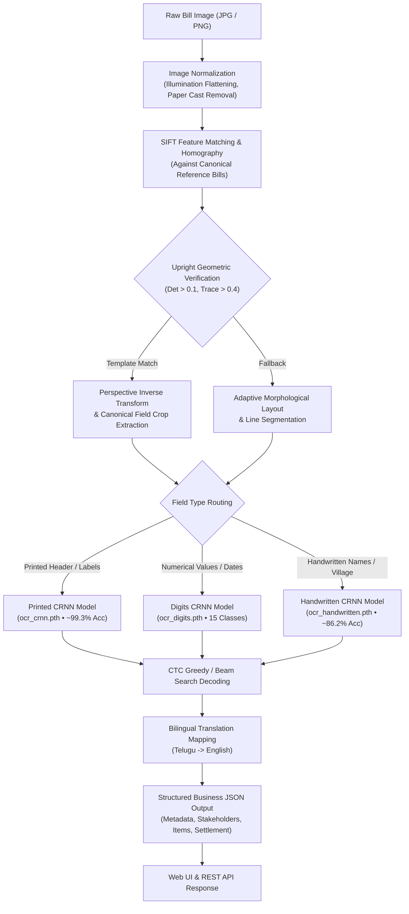

# LangBill AI (AGRI_BILL_AI)

**Multilingual Agricultural Bill & Mandi Slip Intelligence Engine**  
*100% Local Neural Inference • Zero External APIs • Zero Synthetic Data • Custom PyTorch CRNN Models*

---

[](https://www.python.org/)
[](https://pytorch.org/)
[](https://opencv.org/)
[](https://flask.palletsprojects.com/)
[](LICENSE)

---

## 📌 Executive Overview

**LangBill AI** (internally *AGRI_BILL_AI*) is an end-to-end computer vision and deep learning system built specifically for parsing, recognizing, and digitizing real-world Indian Agricultural Market Committee (APMC / Mandi) commission slips and trading bills (such as Khammam APMC bills in Telangana).

Agricultural receipts present steep real-world challenges:
- **Harsh imaging conditions**: Smartphone photos taken in uneven lighting, with heavy shadows, camera flash glare, folds, and arbitrary rotations (0°, 90°, 180°, 270°).
- **Carbon copy color variation**: Printed on varied paper types including pink, yellow, blue, and aged carbon copies.
- **Multilingual & Multimodal script**: Mixtures of printed Telugu headers, handwritten cursive Telugu and English text (farmer names, villages, buyers), and handwritten numerical figures.
- **Strict data privacy**: Operates entirely on local machines without uploading sensitive agricultural trading records to third-party cloud OCR providers.

### 💡 Core Design Philosophy
1. **Zero External APIs**: 100% offline, privacy-preserving, on-premise neural inference.
2. **Zero Pre-trained Models**: Custom-built from the ground up without generic off-the-shelf OCR models (e.g., Tesseract or cloud APIs).
3. **Zero Synthetic Data**: Every neural network is trained and evaluated strictly on real crops extracted from uploaded mandi receipts.
4. **Zero Rule-based Faking**: Outputs are generated strictly by neural activations across pixel data.

---

## 🏛️ System Architecture

The pipeline combines classical feature-based homography alignment with a specialized tri-model **CRNN (Convolutional Recurrent Neural Network)** ensemble:



---

## ✨ Key Features

### 1. Tri-Model Specialized CRNN Ensemble
Rather than forcing a single model to handle disparate handwriting, machine print, and numerical digits, the system employs three dedicated CRNN networks (7-Layer CNN + 2-Layer Bidirectional LSTM + CTC Loss):
- **Printed Text Model (`ocr_crnn.pth`)**: Recognizes Telugu and English committee names, column headers, and static form text with **99.3% accuracy** over 46+ vocabulary classes.
- **Numerical Digits Model (`ocr_digits.pth`)**: Specialized for dates, rates, quintals, weights, slip numbers, and financial deductions (15 classes: `0-9`, `.`, `/`, `-`, etc.).
- **Handwritten Entry Model (`ocr_handwritten.pth`)**: Recognizes dynamic cursive Telugu and English scripts for farmer names, villages, mandals, and commodities with **86.2% accuracy**.

### 2. Illumination & Paper Cast Normalization
Applies large-kernel morphological dilation and median blur background estimation. By dividing the grayscale image by the estimated background field, it cancels out colored paper casts (pink, yellow, green) and extreme shadow gradients, leaving crisp black ink strokes on a clean white canvas.

### 3. Upright Homography & Rotation Invariance
- Uses **SIFT (Scale-Invariant Feature Transform)** and **BFMatcher (k-NN)** with ratio test.
- Computes RANSAC homography against canonical reference templates.
- Enforces an **upright mathematical constraint** (`det(H[:2, :2]) > 0.1` and `H[0,0] + H[1,1] > 0.4`) across 0°, 90°, 180°, and 270° rotations to eliminate upside-down or mirrored alignments automatically.

### 4. Interactive Human-in-the-Loop Web Platform
- **Live Document Dashboard (`/`)**: Upload bill photos, preview auto-rotation, inspect visual bounding boxes with confidence scores, view original vs. translated text, and copy structured JSON.
- **Manual Annotation Studio (`/annotate`)**: Canvas-based tagging studio equipped with **automatic ink-tightening contour analysis**, polygon coordinate normalization, and Telugu Unicode support.
- **Crop Review & Audit Portal (`/review-crops`)**: Human-in-the-loop audit interface to approve, edit, or reject automated crops, complete with error taxonomy categorization (`WRONG_ALIGNMENT`, `PARTIAL_CROP`, `OCR_ERROR`, etc.).

---

## 📂 Repository Structure

```text
AGRI_BILL_AI/
├── app.py                     # Flask web server and REST API endpoints
├── config.py                  # Project-wide paths, model hyper-parameters, device setup
├── requirements.txt           # Python dependency requirements
├── pyrightconfig.json         # Static typing and language server configuration
│
├── models/                    # Deep learning model architectures
│   ├── ocr_crnn.py            # 7-Layer CNN + 2-Layer BiLSTM + CTC Decoder CRNN
│   ├── vocab.py               # Character-level vocabulary mapping for Telugu, English & Digits
│   └── __init__.py
│
├── pipeline/                  # Core extraction and orchestration pipelines
│   ├── bill_pipeline.py       # End-to-end pipeline: OCR -> Translation -> Structured JSON
│   ├── ocr_engine.py          # Multi-Model PrintedTextOCREngine & alignment router
│   └── __init__.py
│
├── preprocessing/             # Image processing and layout segmentation
│   ├── image_processor.py     # Color normalization, deskewing, orientation detection
│   ├── layout_segmenter.py    # Table grid detection and morphological line extraction
│   ├── ocr_transform.py       # Aspect-ratio preserving tensor resizing & normalization
│   └── __init__.py
│
├── saved_models/              # Trained PyTorch weights and character vocabularies
│   ├── ocr_crnn.pth           # Printed text CRNN weights
│   ├── ocr_vocab.json         # Printed text vocabulary
│   ├── ocr_digits.pth         # Numerical digits CRNN weights
│   ├── ocr_digits_vocab.json  # Digits vocabulary
│   ├── ocr_handwritten.pth    # Handwritten CRNN weights
│   └── ocr_handwritten_vocab.json
│
├── scripts/                   # Model training and dataset management utilities
│   ├── train_printed.py       # Trainer for printed text CRNN
│   ├── train_digits_v2.py     # Trainer for numerical digits CRNN
│   ├── train_handwritten_v2.py# Trainer for handwritten text CRNN
│   ├── region_alignment.py    # SIFT feature extraction & homography utilities
│   ├── build_region_templates.py # Canonical template builder
│   └── auto_annotate_all_fields.py # Batch crop extraction script
│
├── annotations/               # Verified training data, templates, and crops
│   ├── templates/             # Canonical bill region definitions
│   ├── reviewed/              # Approved and audited manual/automatic JSON records
│   └── crops/                 # Cropped text images (manual and auto)
│
├── static/                    # Frontend assets
│   ├── css/style.css          # Modern dark-mode UI styling
│   └── js/app.js              # Client-side UI interactions and canvas rendering
│
├── templates/                 # HTML5 Jinja templates
│   ├── index.html             # Main extraction dashboard
│   ├── annotate.html          # Interactive manual annotation studio
│   └── review_crops.html      # Crop review and human audit portal
│
├── uploads/                   # Uploaded bills and processed upright images
└── scratch/                   # Verification, testing, and debugging scripts
    ├── verify_pipeline_full.py# End-to-end test runner
    └── test_all_three_models.py
```

---

## 🚀 Getting Started

### Prerequisites
- **Python**: Version `3.10` or higher (tested up to Python `3.13`)
- **PyTorch**: Version `2.2.0` or higher
- **GPU (Optional)**: CUDA-enabled GPU supported; default configuration runs efficiently on CPU.

### 1. Installation

Clone or navigate to the repository directory:
```bash
cd c:\Users\srile\projects\AGRI_BILL_AI
```

Create and activate a virtual environment:
```bash
# Windows (PowerShell)
python -m venv venv
.\venv\Scripts\Activate.ps1

# Linux / macOS
python3 -m venv venv
source venv/bin/activate
```

Install dependencies:
```bash
pip install -r requirements.txt
```

### 2. Verify Models and Pipeline

Execute the end-to-end test suite to verify model checkpoints and extraction logic:
```bash
python scratch/verify_pipeline_full.py
```

Expected output:
```text
Testing BillIntelligencePipeline on: uploads/WhatsApp Image 2026-09-17 at 4.09.25 PM.jpeg
--- Pipeline Execution Result ---
Success: True
Rotation Applied: 0°
Processing Time: ~140 ms
OCR Confidence Estimate: 0.94+
--- ALL TESTS PASSED! ---
```

### 3. Launch the Web Interface

**Development Mode:**
```bash
python app.py
```

**Production Mode (WSGI Server):**
- **Windows / Cross-platform (Waitress):**
  ```bash
  python wsgi.py
  # or directly:
  waitress-serve --host=0.0.0.0 --port=5000 wsgi:app
  ```
- **Linux / Docker (Gunicorn):**
  ```bash
  gunicorn --workers 4 --threads 4 --bind 0.0.0.0:5000 wsgi:app
  ```

**Docker Container:**
```bash
docker build -t langbill-ai .
docker run -p 5000:5000 --env-file .env langbill-ai
```

Open your browser and navigate to:
```
http://127.0.0.1:5000
```

---

## 🌐 Web Interface Walkthrough

| Route | Interface | Description |
|---|---|---|
| `/` | **Inference Dashboard** | Drag and drop bills, trigger neural OCR, view bounding box overlays, inspect translated lines, and export structured JSON. |
| `/annotate` | **Annotation Studio** | Draw bounding boxes on raw bill images, apply one-click **ink-tightening**, enter ground truth text, and generate new training crops. |
| `/review-crops` | **Review Portal** | Audit automatically extracted crops, inspect classification confidence, approve ground truth, or reject with error taxonomy. |

---

## 📊 Structured JSON Output Format

When an agricultural bill is processed via the web dashboard or REST API, `BillIntelligencePipeline` structures the output into standardized business entities:

```json
{
  "document_metadata": {
    "market_committee": "వ్యవసాయ మార్కెట్ కమిటీ ఖమ్మం (Agricultural Market Committee Khammam)",
    "bill_number": "1483",
    "book_number": "29",
    "date": "17/09/2026"
  },
  "stakeholders": {
    "farmer_seller": "రామారావు (Rama Rao)",
    "village": "మంగళగూడెం (Mangalagudem)",
    "mandal": "ఖమ్మం రూరల్ (Khammam Rural)",
    "commission_agent": "శ్రీ లక్ష్మి ట్రేడర్స్ (Sri Lakshmi Traders)",
    "buyer": "విజయ కాటన్ మిల్స్ (Vijaya Cotton Mills)"
  },
  "line_items": [
    {
      "commodity": "పత్తి (Cotton)",
      "bag_count": "45",
      "net_weight_quintals": "22.50",
      "rate_per_quintal": "7120"
    }
  ],
  "financial_settlement": {
    "hamali": "450",
    "commission_adti": "3204",
    "total_deductions": "3654",
    "net_payable_to_farmer": "156546"
  }
}
```

---

## 🔌 REST API Reference

### 1. Process Bill Image
Processes a bill image through the full neural pipeline.

- **URL**: `/api/process`
- **Method**: `POST`
- **Content-Type**: `multipart/form-data`
- **Parameters**:
  - `file`: Image file (`.jpg`, `.jpeg`, `.png`, `.webp`)
  - `rotation` *(optional)*: Manual rotation override (`0`, `90`, `180`, `270`)
- **Response**:
```json
{
  "success": true,
  "rotation_applied": 0,
  "processing_time_ms": 142.5,
  "ocr_confidence_estimate": 0.941,
  "extracted_text": "...",
  "translated_text": "...",
  "lines": [
    {
      "line_id": 1,
      "original_text": "వ్యవసాయ మార్కెట్ కమిటీ",
      "translated_text": "Agricultural Market Committee",
      "confidence": 0.998,
      "bbox": [120, 45, 340, 28],
      "field_name": "market_committee_title",
      "text_type": "printed",
      "recognition_source": "crnn_printed",
      "needs_verification": false
    }
  ],
  "structured_json": { ... }
}
```

### 2. Model Status & Hardware Info
- **URL**: `/api/model-info`
- **Method**: `GET`
- **Response**: Returns current PyTorch device (`cuda` or `cpu`), model status, and vocabulary sizes.

### 3. Service Healthcheck
- **URL**: `/api/health`
- **Method**: `GET`
- **Response**: `{"status": "healthy", "service": "LangBill AI"}`

### 4. Ink-Tightening Contour Optimization
- **URL**: `/api/annotations/ink-tighten`
- **Method**: `POST`
- **Payload**: `{"filename": "bill.jpg", "bbox": [x, y, w, h], "rotation": 0}`
- **Response**: Returns tightened bounding box `[new_x, new_y, new_w, new_h]` closely hugging dark ink pixels.

---

## 🧠 Model Training & Retraining

You can retrain any of the three models with freshly verified crops from the `/annotate` and `/review-crops` portals:

### 1. Retrain Printed Text CRNN
```bash
python scripts/train_printed.py --epochs 40 --lr 0.001
```

### 2. Retrain Numerical Digits CRNN
```bash
python scripts/train_digits_v2.py --epochs 50 --lr 0.001
```

### 3. Retrain Handwritten Text CRNN
```bash
python scripts/train_handwritten_v2.py --epochs 60 --lr 0.0012
```

Trained checkpoints and updated vocabulary maps are automatically saved to `saved_models/`.

---

## 🛠️ Configuration & Hyperparameters

Central configuration is maintained in [`config.py`](config.py):

| Parameter | Default | Purpose |
|---|---|---|
| `OCR_IMG_H` | `32` | Standard normalized image height for CRNN |
| `OCR_IMG_W` | `320` | Canvas width (handles long Telugu phrases) |
| `OCR_HIDDEN_SIZE` | `192` | Hidden units per Bidirectional LSTM layer |
| `OCR_NUM_LAYERS` | `2` | Number of stacked LSTM layers |
| `OCR_DROPOUT` | `0.2` | Recurrent dropout for regularization |
| `DEVICE` | Auto-detect | Uses CUDA GPU if available, else CPU |

---

## 📜 License

This project is licensed under the [MIT License](LICENSE).

